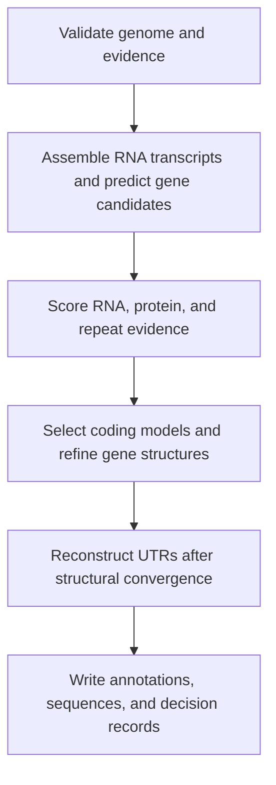

# GeneInIt

**Evidence-guided structural gene annotation for eukaryotic genomes.**

GeneInIt combines GeneMark-ETP and AUGUSTUS predictions with RNA-seq and protein
evidence to select and refine protein-coding gene models. It produces gene and
transcript annotations, nucleotide and protein sequences, and records explaining
how candidate models were selected, replaced, or excluded.

The workflow runs on one nuclear genome assembly at a time using Snakemake.
Its scope is structural annotation; repeat discovery, functional annotation,
and comparative genomics are separate analyses.

> **v0.0.1 — initial development release:** the current v10 selection and structural refinement
> have been evaluated on Cuscuta data, including fixed-input whole-genome replay.
> This does not establish accuracy across plant species or polyploid assemblies,
> or validate a fresh run through every external predictor and UTR tool.

[Inputs](#inputs) · [Quick start](#quick-start) · [Outputs](#outputs) ·
[Policies](#choosing-a-policy) · [Documentation](#documentation)

See the [v0.0.1 release notes](CHANGELOG.md). The software version (`0.0.1`)
and selection-policy version (`v10`) are independent.

## How it works



- **Consistent selection:** under v10, original and repaired candidates are
  scored and selected with the same evidence rules. A longer model does not
  automatically win.
- **Traceable decisions:** selection audits, structural decisions, lineage maps,
  and review flags connect final models to their supporting evidence.
- **Incremental execution:** input, policy, and code dependencies determine
  which stages rerun. A selection-policy change can reuse completed alignment,
  prediction, and evidence-scoring work when their inputs remain unchanged.

Structural refinement can propose repairs and reconsider competing models until
the selected structures converge, subject to the policy's iteration limit.
UTRs are reconstructed afterward, with checks that CDS coordinates and phases
remain unchanged. All output coordinates refer to the input genome.

## Inputs

| Input | Required format |
|---|---|
| Genome | One soft-masked nuclear FASTA; standard genetic code (`1`) |
| Repeats | GFF3 using the same sequence names and coordinates as the genome |
| RNA-seq | Raw FASTQ, or coordinate-sorted splice-aware BAM with CSI indexes |
| Protein evidence | External protein FASTA appropriate for the target species |
| Configuration | YAML with input paths, RNA sample table, assembly metadata, policy, and deployment settings |

Use one RNA input mode per run. In BAM mode, also provide the FASTA used for
alignment as `rna.reference_fasta`; BAI and CRAM inputs are not accepted.
Record library strandedness, conditions, and biological replicates accurately.
See the [input guide](docs/inputs.md) for sample-table formats and validation.

For polyploid organisms, set `reference_representation` and
`expected_protein_copies` to describe the **assembly being annotated**. Organism
ploidy alone does not determine how many copies the assembly contains.

## Quick start

The supported environment is Linux with Conda/Mamba. Full prediction also needs
Apptainer, a locally available GeneMark-ETP/AUGUSTUS image, and the required
GeneMark software and license. Image build instructions are in the
[container guide](containers/README.md); images and license keys are not bundled.

### 1. Get the source and workflow environment

```bash
git clone https://github.com/justezy0210/geneinit.git
cd geneinit
mamba env create --prefix .conda/bootstrap --file envs/bootstrap.yaml
```

Run the following commands from this checkout. The source launcher uses the
workflow files here; installing the Python package alone does not supply the
external prediction tools. For exact CI dependencies, see the
[locked-environment instructions](docs/execution.md#current-verification).

### 2. Configure your dataset and policy

```bash
cp config/config.example.yaml config/config.yaml
```

Edit `config/config.yaml`: replace all placeholder paths and identifiers, prepare
the sample table, and supply the predictor image path and its actual SHA-256.
Set the license acknowledgement only after obtaining the required license.

The example configuration uses `production_v2.json`. To use the current v10
selection rules, replace its `policy` entry with:

```yaml
policy: policies/unified_v10_single_exon50_corroborated_multisample.json
```

### 3. Check inputs, inspect the plan, and run

```bash
# Validate inputs and deployment settings.
conda run --prefix .conda/bootstrap python -m geneinit.cli \
  --threads 16 preflight --configfile config/config.yaml

# Show the pending workflow without running prediction.
conda run --prefix .conda/bootstrap python -m geneinit.cli \
  --threads 16 structural_release --configfile config/config.yaml --dry-run

# Run through structural release staging.
conda run --prefix .conda/bootstrap python -m geneinit.cli \
  --threads 16 structural_release --configfile config/config.yaml
```

Replace `16` with your allocated CPU count. This is the total budget shared by
concurrent workflow jobs. Put the target before `--configfile`.

To resume the same analysis, keep its `execution_root` and `execution_id` and
repeat the command. Inspect a dry run after changing inputs or settings.
For a separate comparison, use a new execution ID and preserve the prior run.
An all-in-one container is also supported; see the [container guide](containers/README.md).

## Outputs

With the example execution settings, the final files are staged under:

```text
runs/ASM1_development_r1/11_release.staging/ASM1/
```

| Files | Contents |
|---|---|
| `annotation.gff3` | Gene, transcript, exon, CDS, and UTR structures |
| `transcripts.fna`, `cds.fna`, `proteins.faa` | Transcript, coding, and protein sequences |
| `longest_proteins.faa` | Longest protein per gene |
| `te_annotation.gff3`, `te_cds.fna`, `te_proteins.faa` | Separate confirmed-TE models and sequences |
| `gene_id_map.tsv`, `transcript_id_map.tsv`, `candidate_lineage.tsv` | Identifier and candidate provenance |
| `structural_decisions.tsv`, `review_flags.tsv`, `structural_qc.*` | Decisions, review flags, and consistency checks |
| `policy.json`, `release_status.json`, `release_manifest.json`, `checksums.sha256` | Applied policy, release status, provenance, and file integrity |

Read `release_status.json` and the review flags before adopting an annotation.
The bundled non-production policies produce staged results with
`PASS_MIGRATION_PENDING`; completion records structural consistency, not
independently established biological accuracy.

## Choosing a policy

| Policy | Intended use |
|---|---|
| `production_v2.json` | Default in the example configuration; retained for the existing selection behavior |
| `unified_v10_single_exon50_corroborated_multisample.json` | Current Cuscuta recommendation; explicit opt-in for unified selection and structural refinement |

The v10 single-exon minimum is **50 amino acids**. Candidates must still meet
ORF, structural, and evidence requirements. Its ranking considers RNA/protein
agreement, coding-boundary conflicts, and support from distinct RNA sample
sources. Passing the length threshold alone does not admit a model.

The v10 policy retains its frozen `EXPERIMENTAL_NOT_VALIDATED` status marker;
completed project-specific replay checks have not promoted it to a general
production policy. The name `production_v2` likewise does not override its
recorded migration status.

## Testing and validation

Run the public unit tests in the workflow environment:

```bash
conda run --prefix .conda/bootstrap python -m pytest tests/unit -q
```

Synthetic fixtures are included. Tests needing the optional private
`tests/data/jinju_*.json` files are explicitly skipped when those files are absent.
They run normally when the local fixtures are available; see
[CONTRIBUTING.md](CONTRIBUTING.md).

Unit tests cover selection rules, evidence handling, incremental scheduling,
and output consistency. Fixed-input biological replays assess changes against
existing runs. Neither is a benchmark demonstrating superiority over other
annotation tools, and neither replaces validation on a new species.

## Documentation

- [Required inputs and BAM reuse](docs/inputs.md)
- [Execution, training, and implementation reference](docs/execution.md)
- [Container builds and execution](containers/README.md)
- [Incremental execution and validation scope (Korean)](docs/development/incremental_execution.md)
- [Selection development and policy history](docs/development/unified_selection.md)
- [TE evidence and separate output rules](docs/te-evidence.md)
- [Scaling and streaming](docs/scalability.md)
- [Historical regression checks](docs/development/golden_regression.md)

## Citation and licensing

Citation metadata is still being finalized; [CITATION.cff](CITATION.cff) currently
contains placeholder author information. Record the repository commit, policy,
input provenance, and tool versions with your results, and cite the underlying
tools used in your run.

A project license has not yet been added to this checkout. Third-party software
has its own terms; GeneMark archives, keys, and private images are not included
in this repository.
