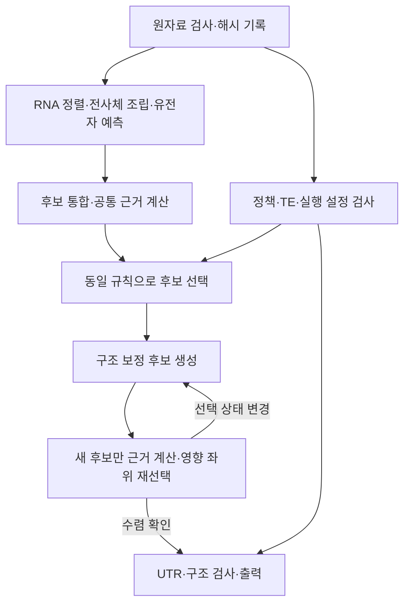

# GeneInIt 실행 구조

v10의 모델 선택 규칙은 유지하고, 재실행 경계와 공통 계산을 정리했다.
원자료부터 결과까지의 계산은 기존 Snakemake DAG가 관리한다.



## 어떤 변경이 어디서부터 다시 실행되는가

| 변경 | 다시 실행하는 범위 |
|---|---|
| 입력·설정·코드 변경 없음 | 실행할 작업 없음 |
| 선택 정책 또는 TE 근거 | 설정 검사와 선택 이후; 정렬·예측·근거 점수는 재사용 |
| 예상 단백질 복제수 | 설정 검사와 근거 점수 이후; 정렬·예측은 재사용 |
| junction 검출 문턱 | junction 근거부터; RNA 정렬과 예측은 재사용 |
| 원 FASTQ/BAM·참조·입력 표 변경 | 원자료 검사부터 영향을 받는 하류 단계 |
| AUGUSTUS 훈련 설정 | 해당 예측 단계 이후; RNA 정렬은 재사용 |
| Python 근거·선택·후처리 코드 | 해당 모듈을 사용하는 단계 이후 |
| 공개 ID 접두사 등 출력 설정 | 설정 검사와 선택 이후를 보수적으로 재실행 |

설정 검사를 일반 의존성으로 유지하므로 출력 설정만 바꿔도 선택 이후는
다시 계산할 수 있다. 검증 실패를 건너뛰거나 변경된 출력이 누락되는 것을
피하기 위한 경계다. 비싼 정렬·예측·근거 점수 계산까지 전파하지 않는다.
공유 모듈의 파일 전체가 의존성 단위이며 함수별 변경을 추론하지 않는다.

## 중복 구현과 계산을 줄인 부분

- `EvidenceContext`가 RNA·단백질·반복서열의 로딩, 인덱스 및 점수 계산을
  담당한다. 초기 후보와 보정 후보가 같은 구현을 쓴다. 새 보정 구조에는
  실제 좌표로 새 근거를 계산하며 부모 점수를 상속하지 않는다.
- 근거 인덱스는 각 실행 단계 안에서 한 번 만든다. 별도 프로세스로 실행하는
  초기 근거 단계와 후처리 사이의 메모리를 공유하는 디스크 캐시는 도입하지 않았다.
- 후처리의 직전 상태 해시를 다음 회차에 재사용한다. N회 반복 시 전체 상태
  해시는 2N회에서 N+1회로 줄고, 수렴 기록의 내용은 유지한다.
- 선택 여부만 필요할 때 전체 정렬을 하지 않는다. 보정 후 노드 전체를
  반복해서 순회하던 부분은 한 번의 조회표 구성과 변경 후보 조회로 바꿨다.
- 입력 검사 기록은 경로·파일 상태·payload 해시를 확인하고 재사용한다.
  원자료가 바뀌면 다시 검사하며, 정책 변경마다 FASTQ/BAM을 재해시하지 않는다.
- `contracts/workflow.py`의 명시적 코드 입력 그룹은 script가 import하는
  로컬 모듈도 추적한다. 새 import를 추가하면 의존성 테스트도 통과해야 한다.

수렴 확인, 새 구조의 재점수, 새 경쟁 후보가 생긴 좌위의 재선택은 필요한
작업이므로 유지한다. 유전자 선택 문턱이나 사례별 예외는 추가하지 않았다.

## 한 작업 공간에서 계속 실행하기

기존 CLI를 사용한다. 같은 분석을 재개할 때는 같은 `execution_root`와
`execution_id`를 유지하고, 변경한 입력·정책·코드를 Snakemake가 판정하게 한다.
`--forceall`은 모든 단계를 다시 실행하므로 통상 재개 명령에 넣지 않는다.

```bash
geneinit-run --threads 8 --configfile run_config.json --dry-run
geneinit-run --threads 8 --configfile run_config.json
```

실제 CPU·메모리는 예약한 자원과 맞춘다. 실험실 실행은 Cowork로 제출한다.
처음 사용하는 작업 공간에는 결과가 없으므로 상류 계산도 필요할 수 있다.
기존 파일이 있다는 이유만으로 완료 기록을 만들거나 날짜를 바꾸어 실행을
건너뛰지 않는다. 다른 실행 결과를 재사용할 때는 입력과 근거의 동일성을
먼저 검증한다. 기존 component에 v10 표본 출처 필드가 없으면 재계산이 필요하다.

## 검증과 범위

단위 검사와 실제 Snakemake 스케줄 검사에 더해, 고정 v10과 초기 근거표 및
전체 후보 선택·후처리 산출물을 비교한다. 완료 상태와 파일 해시는 작업 공간의
`validation/` 기록을 따른다. 스케줄 검사의 무거운 단계는 비활성 placeholder로
구성하며 실제 mapping/predictor 프로그램을 실행하지 않는다.

이번 변경은 v10과 같은 결과를 더 일관되게 재현하기 위한 코드 정리다.
새로운 생물학적 정확도나 실행 시간의 개선율을 주장하지 않는다. 운영 이미지
교체와 확정 주석 채택은 별도 상태로 기록한다.
